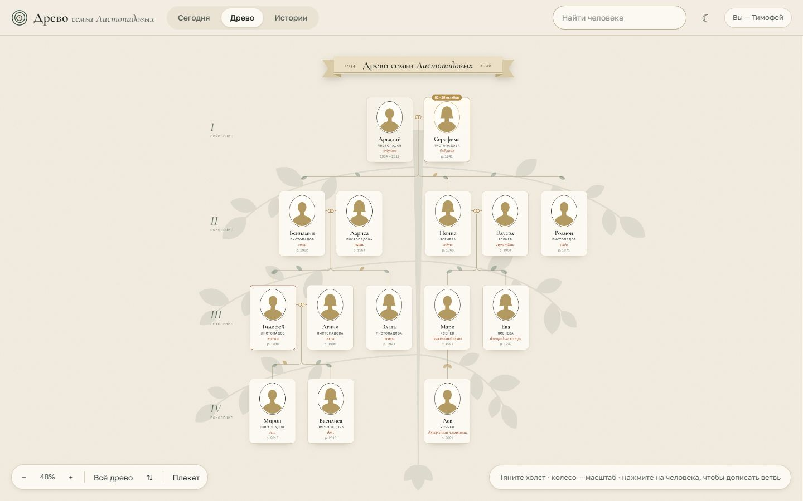
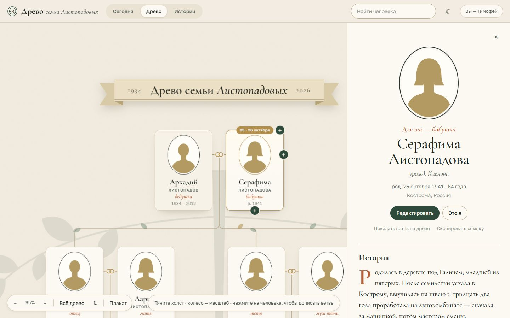
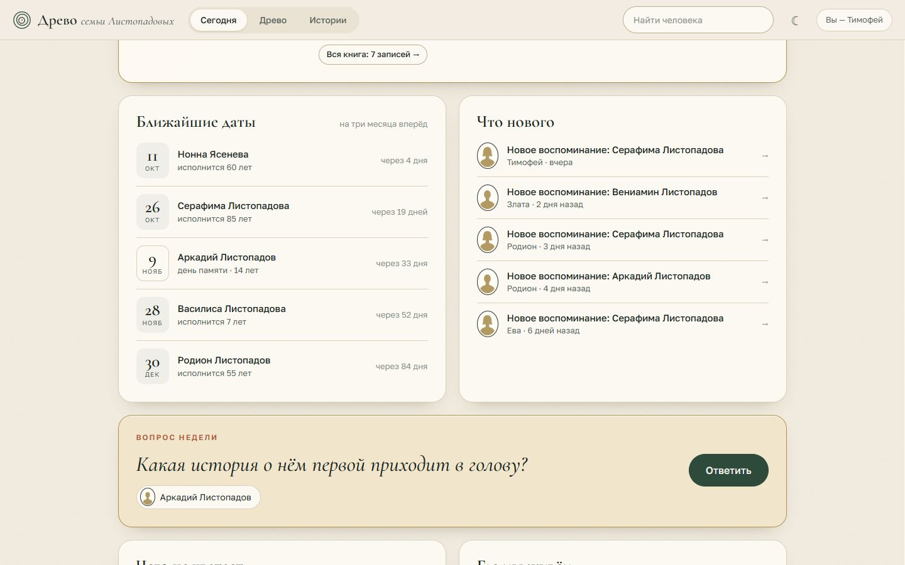
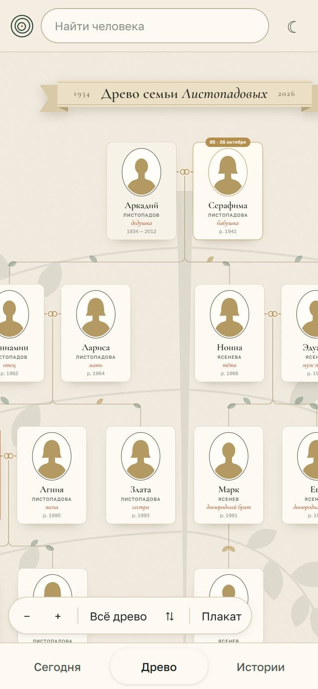

# GrabTree

Семейное древо, которое родные заполняют сами. Один человек ставит сайт на свой сервер и отправляет ссылку-приглашение в семейный чат. Остальные заходят по кодовому слову, находят себя, дописывают ветви, загружают фотографии и оставляют воспоминания.

Я писал его для своей семьи. В репозитории только код: оформление, клиент и сервер. Людей со скриншотов не существует, это демо-семья из `scripts/demo-family.mjs`.



## Что есть на сайте

- Древо на холсте: его можно таскать, масштабировать, перевернуть корнями вниз, показать одну ветвь.
- Карточка человека: даты, город, история, фотографии и воспоминания родных с сердечками.
- «Кем приходится»: отмечаешь себя, и под каждым появляется подпись — бабушка, двоюродный брат, жена дяди.
- Страница «Сегодня»: ближайшие дни рождения и дни памяти, лента правок, вопрос недели о ком-то из старших, список того, чего в древе не хватает, и где живёт семья.
- Книга к дню рождения старшего в роду: по одной записи на каждый год его жизни.
- Лента историй, две темы оформления и плакат А3 для печати.

| Карточка человека | «Сегодня» |
|---|---|
|  |  |



## Запуск

Нужен Node.js 20.12 или новее. Зависимостей нет, `npm install` не требуется.

```
npm start
```

Сайт откроется на http://localhost:3000. При первом запуске сервер создаёт папку `data/`, придумывает два кода доступа и печатает их в консоль.

Посмотреть на заполненное древо, ничего не настраивая:

```
npm run demo
```

Демо поднимается на временной папке с выдуманной семьёй, слушает только `localhost` и стирает данные при остановке.

## Настройки

Сервер читает переменные окружения или файл `.env` в корне проекта. Образец с пояснениями лежит в `config/env.example`. Всё необязательно.

| Переменная | По умолчанию | Что задаёт |
|---|---|---|
| `PORT` | `3000` | порт |
| `HOST` | `0.0.0.0` | адрес; за прокси ставьте `127.0.0.1` |
| `DATA_DIR` | `data` | папка с данными, путь считается от корня проекта |
| `TRUST_PROXY` | `0` | сколько своих прокси стоит перед сервером |
| `FAMILY_CODE`, `ADMIN_CODE` | создаются сами | коды доступа, не короче 8 символов |
| `FAMILY_SURNAME` | пусто | название древа при первом запуске: «Древо семьи …» |
| `UPLOADS_LIMIT_MB` | `5000` | сколько места могут занять все фотографии |

## Где лежат данные

Всё в папке `data/`, в git она не попадает:

- `db.json` — древо целиком: люди, связи, истории, воспоминания;
- `uploads/` — фотографии;
- `backups/` — копии `db.json` по дням, хранятся последние 30;
- `journal.ndjson` — журнал правок: кто, когда и что изменил. Удалённый человек записывается туда целиком, его можно вернуть руками;
- `access.json` и `secret.key` — коды доступа и ключ подписи cookie.

Бэкапить нужно всю папку. Кнопка «Скачать резервную копию» в настройках хранителя отдаёт только `db.json`, без фотографий.

## Коды доступа

Учётных записей нет. Есть два кода.

**Кодовое слово семьи** знают все родные. Оно же зашито в ссылку-приглашение после `#invite=`, поэтому по ссылке достаточно представиться. С этим кодом можно читать и править всё древо. Удалить человека или воспоминание может тот, кто его добавил.

**Код хранителя** даёт то же самое плюс настройки: название древа, выбор именинника для книги, резервная копия и удаление чего угодно.

Вход запоминается в подписанной cookie на 180 дней. Смена любого из двух кодов завершает все сессии сразу — так же отзывается утёкшее приглашение. Отозвать одну сессию нельзя. Коды меняются в `.env` или в `data/access.json`, после этого сервер нужно перезапустить.

От подбора защищают два счётчика: 8 неверных кодов с одного адреса за 15 минут (у IPv6 адресом считается сеть /64) и 100 неверных со всех адресов вместе. Когда общий счётчик исчерпан, вход закрыт для всех до конца этих 15 минут. Тех, кто уже вошёл, это не задевает.

Без входа видна только обложка с названием древа. Люди, фотографии и тексты отдаются после входа.

## Как устроено

Сервер — пять модулей в `server/` на встроенных модулях Node:

- `index.mjs` — запуск и чтение настроек;
- `app.mjs` — маршруты `/api/*`, раздача статики и фотографий, заголовки безопасности;
- `auth.mjs` — коды, подписанные cookie, защита от подбора;
- `db.mjs` — данные, проверка ввода и прав, журнал, копии;
- `http.mjs` — чтение тела с лимитом, JSON-ответы, отдача файлов.

Древо живёт в памяти и после каждой правки целиком пишется в `db.json`: сначала во временный файл, потом подменой. Записи идут строго по очереди. Фотография проверяется по первым байтам (JPEG, PNG, WebP), получает случайное имя и отдаётся только вошедшим.

Клиент в `src/` — ES-модули без сборки и без фреймворка. Весь DOM собирается одной функцией `h()`, текст людей попадает только в текстовые узлы. Раз в 45 секунд страница спрашивает у сервера, не изменилось ли что-нибудь.

Тесты на `node:test`: API через настоящий HTTP на временной папке, раскладка древа, родство, даты, демо-семья.

```
npm test
```

## За nginx или Caddy

HTTPS сервер сам не умеет, его даёт прокси. В `.env`:

```
HOST=127.0.0.1
TRUST_PROXY=1
```

nginx:

```nginx
server {
    server_name tree.example.com;
    client_max_body_size 8m;   # фотография до 6 МБ

    location / {
        proxy_pass http://127.0.0.1:3000;
        proxy_set_header Host $host;
        proxy_set_header X-Forwarded-For $proxy_add_x_forwarded_for;
        proxy_set_header X-Forwarded-Proto $scheme;
    }
}
```

Caddy передаёт нужные заголовки сам:

```
tree.example.com {
    reverse_proxy 127.0.0.1:3000
}
```

`TRUST_PROXY` должен совпадать с числом прокси. Если поставить 1 и открыть сервер напрямую, адрес посетителя можно подделать заголовком. Если оставить 0 за прокси, все посетители считаются одним адресом и восемь чужих опечаток закроют вход всей семье.

## Ограничения

- Один процесс на одну папку данных. Два сервера на одной `data/` затрут правки друг друга.
- База целиком в памяти и переписывается при каждой правке. Для семьи хватает с запасом, потолок — 5000 человек.
- Имя при входе никто не проверяет: любой, кто знает кодовое слово, может подписаться как угодно и править что угодно. Всё держится на доверии внутри семьи и на журнале правок.
- Фотография, убранная из карточки, остаётся на диске. Журнал правок тоже только растёт.
- Шрифты грузятся с Google Fonts. Если нужен сайт без внешних запросов, шрифты придётся положить рядом.
- Интерфейс только на русском, родство считается по русским названиям.
